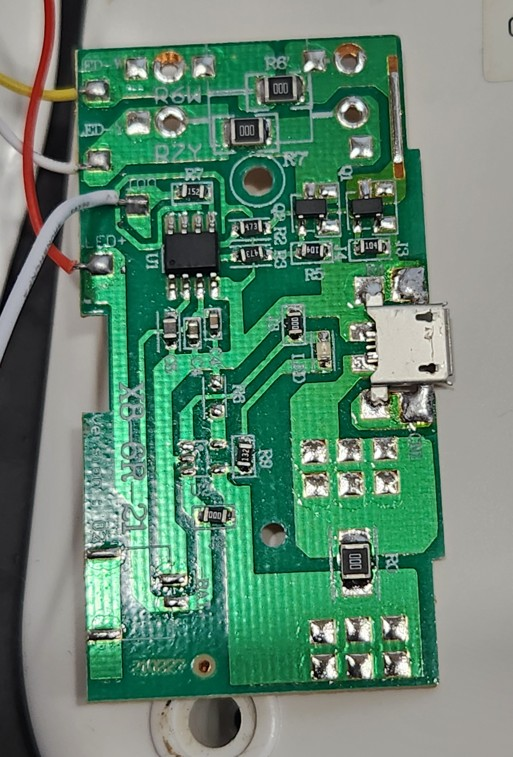
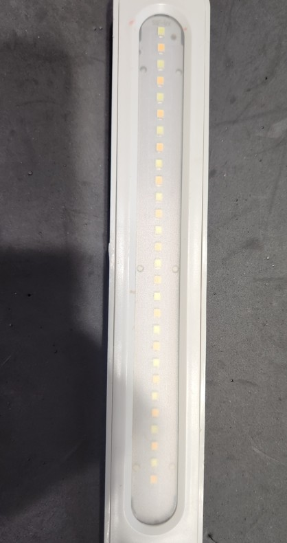

# 💡 Ridy-10-Lite Smart Desk Lamp Core (ESP32-S3)

A high-precision, dual-channel LED lighting controller and smart desk lamp retrofit engineered around the **ESP32-S3** microcontroller and the stock **Ridy-10-Lite (X8-6R-21)** power stage. Built on **PlatformIO** with the **Arduino** framework, this project demonstrates how **reverse-engineering and retrofitting commercial consumer hardware** with an accessible, cost-effective MCU achieves deterministic flicker-free dimming, reliable capacitive sensing through plastic enclosures, and an optimal **price-to-performance ratio**. Designed initially as a **Stage 1 DIY hardware prototype**, its clean GPIO architecture and non-blocking firmware structure are engineered for seamless **Stage 2 sensor fusion (mmWave presence + ambient lux) and smart-home scaling**.

## 📸 Hardware & Retrofit Gallery

> *Tip: Replace these placeholders with photos of your PCB modification, wiring layout, and lighting modes.*

| Stock PCB Retrofit (`X8-6R-21`) | ESP32-S3 Wiring & Type-C Mod | Warm / Cool / Mixed Modes |
| :---: | :---: | :---: |
|  |  |  |

---

## 🎨 Lighting Architecture & User Interaction

Retaining the original dual-LED array while replacing the stock 8-pin SOP-8 controller (`U1`) unlocks full digital control over color temperature and luminous intensity:

- **4-State Deterministic Lighting Cycle:**
  - **Mode 0 (Standby):** Complete MOSFET gate discharge (`0%` Cool / `0%` Warm) for zero parasitic LED glow.
  - **Mode 1 (Warm Relax — ~3000K):** Dedicated warm yellow channel (`Q2`) driven at ~78% duty cycle (`800 / 1023`) for low-blue-light evening tasks.
  - **Mode 2 (Cool Focus — ~6000K):** Dedicated cool white channel (`Q1`) driven at ~78% duty cycle (`800 / 1023`) for high-contrast desk work.
  - **Mode 3 (Balanced Daylight — ~4500K):** Dual-channel simultaneous mixing (`512 / 1023` Cool + `512 / 1023` Warm) for neutral color rendering.
- **Seamless Through-Enclosure Capacitive Touch:** Directly interfaces with the factory internal copper foil electrode via the ESP32-S3 hardware touch peripheral (`GPIO 1`), preserving the clean, buttonless industrial design of the lamp housing.

## ⚡ Hardware Reverse-Engineering & Firmware Optimization

Replacing a dedicated ASIC controller (`U1` SOP-8) on the **X8-6R-21 (5V / 2A)** driver board with an **ESP32-S3-DevKitC-1** required careful electrical matching and signal conditioning:

1. **MOSFET Gate Drive & PWM Frequency Matching (`AO3400A`):**
   - *Analysis:* The stock board utilizes two N-channel **AO3400A** (`A09T`) MOSFETs (`Q1` Cool, `Q2` Warm) with **100 kΩ** pull-down resistors (`R4`, `R5`) and **47 kΩ** series gate resistors (`R3`, `R2`). Because 47 kΩ limits gate charge/discharge current, excessive PWM frequencies cause slow switching transitions and linear-region heating.
   - *Solution:* Configured the ESP32-S3 LEDC hardware timer to **1000 Hz** with **10-bit resolution (0–1023)**—eliminating visible camera/eye flicker while keeping switching losses and MOSFET thermal dissipation negligible.
2. **Dynamic Boot-Time Capacitive Baseline Calibration:**
   - *Challenge:* Parasitic capacitance on the internal copper foil antenna shifts significantly depending on power source grounding (e.g., floating 5V wall adapter vs. grounded PC USB port) and ambient humidity.
   - *Resolution:* Implemented an automated **30-sample startup calibration routine** (`calibrateTouch()`) that establishes a dynamic baseline reference, paired with extended hardware measurement cycles (`touchSetCycles(0x2000, 0x1000)`) to penetrate the plastic shell reliably.
3. **Noise Filtering & Hysteresis State Machine:**
   - *Implementation:* Combines a **4-sample moving average** per loop iteration with an asymmetric **Schmitt-trigger hysteresis threshold** (`+1800` delta to trigger ON, `< +1000` delta to release OFF), completely eliminating false triggers from PWM switching noise or power supply ripple.
4. **Power Stage & USB Type-C Modernization:**
   - Replaced the legacy micro-USB port with **USB Type-C** (`5V / 2A` input) and tapped directly into the `J3` / `U1 Pin 1` 5V rail (recommended with a series Schottky diode to prevent back-feeding USB host ports during flashing).

## 🔌 Hardware Pinout & Interface Map

| Component / Signal | Stock PCB Point (`X8-6R-21`) | ESP32-S3 Pin | Technical Notes |
| :--- | :--- | :--- | :--- |
| **Power `+5V`** | Upper pad of jumper `J3` (or `U1 Pin 1`) | `5V (VIN)` | 5V / 2A rail (Schottky diode isolation recommended) |
| **Ground (`GND`)** | USB shield / `U1 Pin 8` | `GND` | Common system ground |
| **Cool White PWM** | White wire before `R3` (`47 kΩ` -> `Q1`) | `GPIO 4` | LEDC Channel 0 (`1 kHz`, 10-bit) |
| **Warm Yellow PWM** | Blue wire before `R2` (`47 kΩ` -> `Q2`) | `GPIO 5` | LEDC Channel 1 (`1 kHz`, 10-bit) |
| **Capacitive Touch** | Thick white wire from copper foil | `GPIO 1` | Hardware Touch1 (`touchSetCycles` boosted) |
| **Ambient Light SDA** *(Stage 2)* | — | `GPIO 8` | I2C SDA (`3.3V` logic) for **BH1750** |
| **Ambient Light SCL** *(Stage 2)* | — | `GPIO 9` | I2C SCL (`3.3V` logic) for **BH1750** |
| **mmWave Radar RX** *(Stage 2)* | — | `GPIO 17` | UART TX (`256000 baud`) -> **HLK-LD2410** RX |
| **mmWave Radar TX** *(Stage 2)* | — | `GPIO 18` | UART RX (`256000 baud`) <- **HLK-LD2410** TX |

## 🚀 Roadmap: Stage 2 Sensor Fusion & Automation

The hardware pinout and firmware architecture are pre-allocated for upcoming autonomous features:

- [x] **Stage 1 (Current):** PCB reverse-engineering, USB-C retrofit, 10-bit dual-channel PWM driver, auto-calibrated capacitive touch controller.
- [ ] **Stage 2A — Adaptive Daylight Harvesting (`BH1750`):** Closed-loop PID/proportional brightness adjustment via I2C (`GPIO 8/9`) to maintain constant desk illuminance (lux) as ambient room lighting changes.
- [ ] **Stage 2B — Zero-Latency Presence Automation (`HLK-LD2410`):** 24 GHz mmWave radar integration via UART (`GPIO 17/18`, `256000 baud`) for micro-motion occupancy detection, soft fade-in on approach, and automatic timeout shutoff.
- [ ] **Stage 3 — Wireless Telemetry & Smart Home:** Wi-Fi / ESP-NOW / MQTT integration with NVS state persistence and smooth exponential brightness ramping.

## 📂 Project Structure

```text
Ridy-10-Lite-ESP32S3/
├── platformio.ini          # Locked Espressif32 @ 6.7.0 environment & UART monitor flags
└── src/
    └── main.cpp            # PWM driver, startup touch calibration, hysteresis state machine
```

## 🛠 Hardware & Tech Stack

- **MCU:** ESP32-S3-DevKitC-1 (Xtensa LX7 Dual-Core @ 240 MHz)
- **Power & Driver Stage:** Retrofitted `X8-6R-21` PCB (`5V / 2A` USB-C, dual `AO3400A` N-MOSFETs)
- **Planned Peripherals:** `BH1750` I2C Ambient Light Sensor (`3.3V`), `HLK-LD2410` 24 GHz mmWave Presence Radar (`5V` power / `3.3V` UART)
- **Framework & Toolchain:** Arduino Core (`espressif32 @ 6.7.0`) via PlatformIO