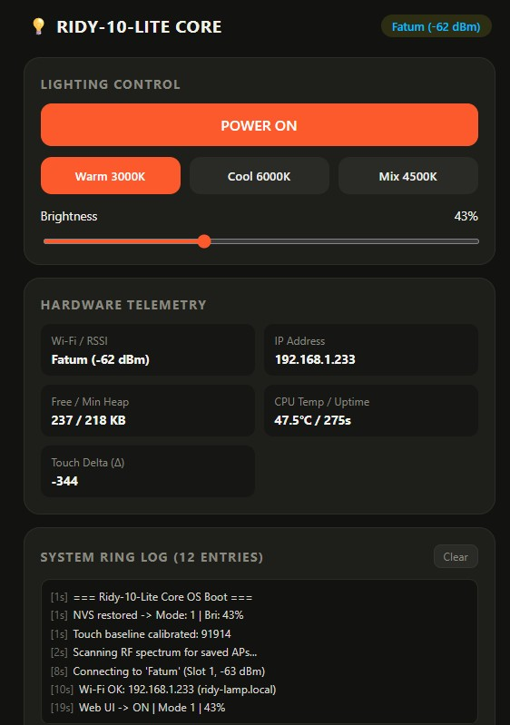

# 💡 Ridy-10-Lite Smart Desk Lamp Core OS (ESP32-S3)

A high-precision, dual-channel LED lighting controller and smart desk lamp retrofit engineered around the **ESP32-S3** microcontroller and the stock **Ridy-10-Lite (X8-6R-21)** power stage. Built on a clean, modular C++ architecture using **PlatformIO** and the **Arduino** framework, this project transforms commercial consumer hardware with gamma-corrected Soft-Fade dimming, through-enclosure capacitive touch sensing, zero-fragmentation ring-buffer diagnostics, autonomous Multi-AP Wi-Fi roaming, and wireless OTA firmware updates.

## 📸 Hardware & Web UI Gallery

| Stock PCB Retrofit (`X8-6R-21`) | ESP32-S3 Wiring & Type-C Mod | Embedded Dark-Mode Web Admin |
| :---: | :---: | :---: |
|  |  |  |

---

## 🎨 Lighting Engine & Capacitive Interaction (`LampController`)

- **Gamma-Corrected Soft-Fade & 3-Mode Color Cycle:**
  - **Mode 1 (Warm Relax — ~3000K):** Dedicated warm yellow channel (`Q2`).
  - **Mode 2 (Cool Focus — ~6000K):** Dedicated cool white channel (`Q1`).
  - **Mode 3 (Balanced Daylight — ~4500K):** Dual-channel mixing capped at `55%` duty cycle per rail (`MIX_CHANNEL_LIMIT`) to protect the `5V / 2A` power supply.
  - **Quadratic Gamma Curve & Soft-Fade:** Perceptually linear dimming paired with smooth exponential transitions (`FADE_SPEED_SWITCH` / `FADE_SPEED_DIMMING`).
- **Single-Electrode Gesture State Machine (`GPIO 1`):**
  - **Short Tap (`45 ms – 450 ms`):** Cycles through `Warm` → `Cool` → `Mix` → `Off`.
  - **Long Press (`> 450 ms`):** Engages continuous bidirectional dimming (`10%` – `100%`) with automatic direction reversal upon release.

## ⚡ Hardware Reverse-Engineering & Firmware Optimization

1. **MOSFET Gate Drive & PWM Frequency (`AO3400A`):** Configured the ESP32-S3 LEDC hardware timer to `1000 Hz` with `10-bit resolution (0–1023)` to eliminate camera/eye flicker while matching the `47 kΩ` series gate resistors (`R3`, `R2`) on the stock `AO3400A` MOSFETs (`Q1`, `Q2`) for negligible switching heat.
2. **Capacitive Touch Calibration & Hysteresis:** Tuned hardware measurement cycles (`touchSetCycles(0x0800, 0x1000)`), a 30-sample boot calibration routine (`calibrateTouch()`), a 4-sample moving average, and an asymmetric Schmitt-trigger hysteresis threshold (`+3500` ON / `< +2000` OFF) to prevent false air-gap triggers.
3. **Flash Wear-Leveling NVS State Persistence:** Uses a 3-second debounced lazy-save pipeline (`NVS_SAVE_DELAY_MS`) to commit brightness and active mode to non-volatile `Preferences` without wearing out SPI Flash sectors during smooth dimming sweeps.
4. **Zero-Fragmentation Ring-Buffer Logger (`SysLogger`):** Fixed-size static circular buffer (`12 entries × 84 chars`) streaming color-coded `INFO`, `WARN`, and `ERR` events simultaneously to `Serial` and the Web UI without dynamic heap allocation.
5. **Power Stage & USB Type-C Modernization:** Replaced the legacy micro-USB connector with **USB Type-C** (`5V / 2A`) tied into the `J3` / `U1 Pin 1` 5V rail.

## 🔒 Autonomous Network Stack, Web UI & Wireless OTA (`NetManager`)

The asynchronous network module (`ESPAsyncWebServer` + `ArduinoJson`) hosts an embedded `PROGMEM` single-page app styled in the Core OS dark-graphite aesthetic (`#FC5A2C` Grapefruit & `#00BEFF` Cyan accents). See **[HowToUseWiFiOTA.md](HowToUseWiFiOTA.md)** for full setup and OTA instructions.

- **Multi-AP Wi-Fi Roaming & Reconnect Watchdog:** Scans the RF spectrum on boot and connects to the strongest of up to **6 saved SSIDs** stored in NVS, with automatic fallback to `RidyLamp-AP` (`192.168.4.1`) and a 15-second non-blocking reconnect watchdog.
- **HTTP Basic Authentication & REST API:** Protects `/`, `/api/telemetry`, `/api/control`, `/api/config`, `/api/save`, and `/api/logs/clear` behind configurable credentials stored in NVS.
- **Live Hardware Telemetry & ArduinoOTA:** Real-time monitoring of Wi-Fi RSSI, free/minimum heap watermarks, internal silicon temperature (`temperatureRead()`), live capacitive `Touch Delta (Δ)`, uptime, and password-protected Over-The-Air updates (`ridy-lamp.local`).

## 🔌 Hardware Pinout & Interface Map

| Component / Signal | Stock PCB Point (`X8-6R-21`) | ESP32-S3 Pin | Technical Notes |
| :--- | :--- | :--- | :--- |
| **Power `+5V`** | Upper pad of jumper `J3` (or `U1 Pin 1`) | `5V (VIN)` | 5V / 2A rail (Schottky diode isolation recommended) |
| **Ground (`GND`)** | USB shield / `U1 Pin 8` | `GND` | Common system ground |
| **Cool White PWM** | White wire before `R3` (`47 kΩ` -> `Q1`) | `GPIO 4` | LEDC Channel 0 (`1 kHz`, 10-bit) |
| **Warm Yellow PWM** | Blue wire before `R2` (`47 kΩ` -> `Q2`) | `GPIO 5` | LEDC Channel 1 (`1 kHz`, 10-bit) |
| **Capacitive Touch** | Thick white wire from copper foil | `GPIO 1` | Hardware Touch1 (`0x0800` cycle tuned) |
| **Ambient Light SDA** *(Stage 2)* | — | `GPIO 8` | I2C SDA (`3.3V` logic) for **BH1750** |
| **Ambient Light SCL** *(Stage 2)* | — | `GPIO 9` | I2C SCL (`3.3V` logic) for **BH1750** |
| **mmWave Radar RX** *(Stage 2)* | — | `GPIO 17` | UART TX (`256000 baud`) -> **HLK-LD2410** RX |
| **mmWave Radar TX** *(Stage 2)* | — | `GPIO 18` | UART RX (`256000 baud`) <- **HLK-LD2410** TX |

## 📂 Modular Project Structure

```text
Ridy-10-Lite-ESP32S3/
├── platformio.ini              # Locked Espressif32 @ 6.7.0, libraries & OTA configuration
├── HowToUseWiFiOTA.md          # Wi-Fi provisioning, Multi-AP & ArduinoOTA documentation
├── README.md                   # Project architecture & hardware documentation
└── src/
    ├── main.cpp                # Non-blocking loop and hardware module orchestration
    ├── config/
    │   └── config.h            # GPIO pinout, PWM parameters, touch thresholds & timings
    ├── lamp/
    │   ├── lamp_controller.h   # Lighting & touch controller interface
    │   └── lamp_controller.cpp # Gamma Soft-Fade, bidirectional dimming, touch & NVS lazy-save
    ├── network/
    │   ├── net_manager.h       # Network & REST API manager interface
    │   ├── net_manager.cpp     # 6-AP roaming, mDNS, watchdog, Basic Auth & ArduinoOTA
    │   └── web_ui.h            # Embedded PROGMEM dark-mode Web Admin SPA & log console
    └── system/
        ├── sys_logger.h        # Zero-heap circular log buffer interface
        └── sys_logger.cpp      # 12-entry ring logger mirrored to Serial & Web UI
```

## 🚀 Roadmap: Stage 2 Sensor Fusion & Automation

- [x] **Stage 1 (Completed):** PCB reverse-engineering, USB-C retrofit, 10-bit dual-channel PWM, gamma Soft-Fade, bidirectional touch dimming, NVS state persistence, `SysLogger`, 6-AP Wi-Fi roaming, Web Admin UI, and ArduinoOTA.
- [ ] **Stage 2A — Adaptive Daylight Harvesting (`BH1750`):** Closed-loop brightness regulation via I2C (`GPIO 8/9`) to maintain constant desk illuminance (lux).
- [ ] **Stage 2B — Zero-Latency Presence Automation (`HLK-LD2410`):** 24 GHz mmWave radar integration via UART (`GPIO 17/18`, `256000 baud`) for micro-motion occupancy detection, soft fade-in on approach, and automatic timeout shutoff.